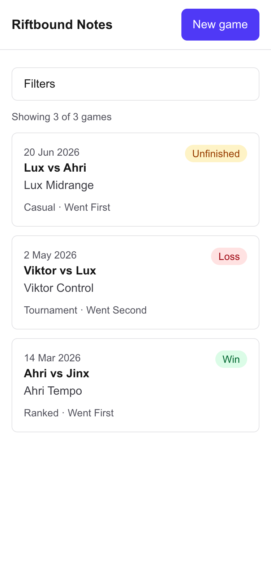
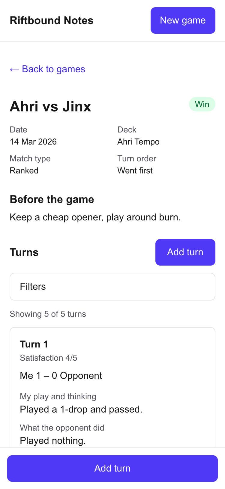
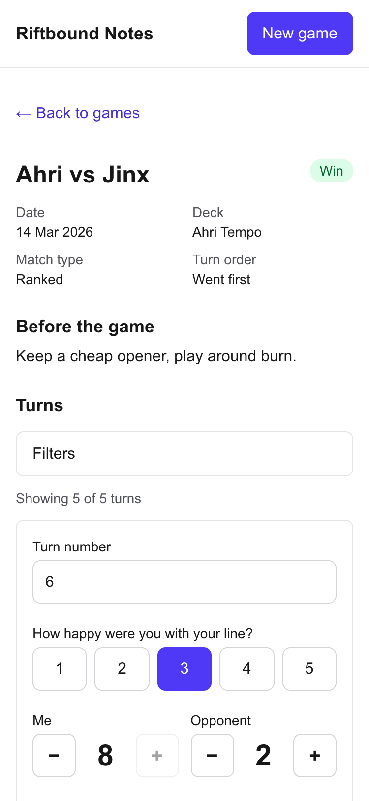
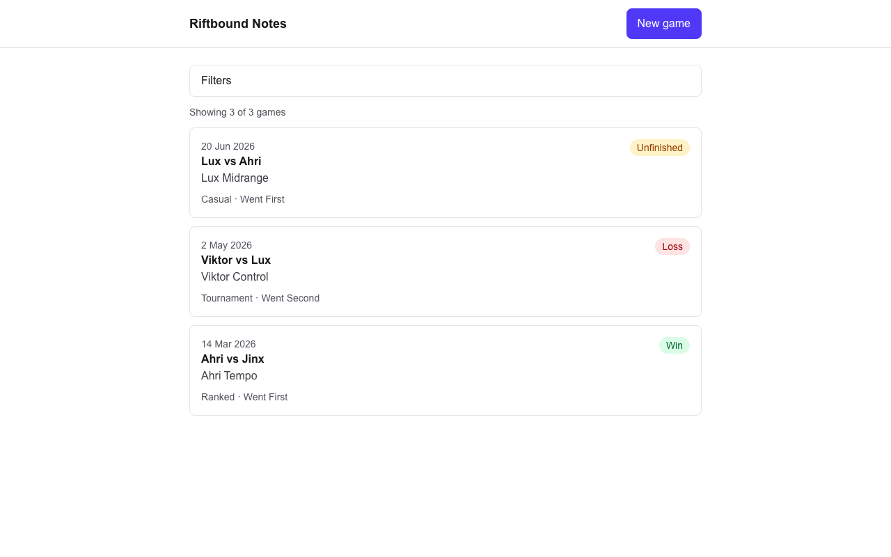
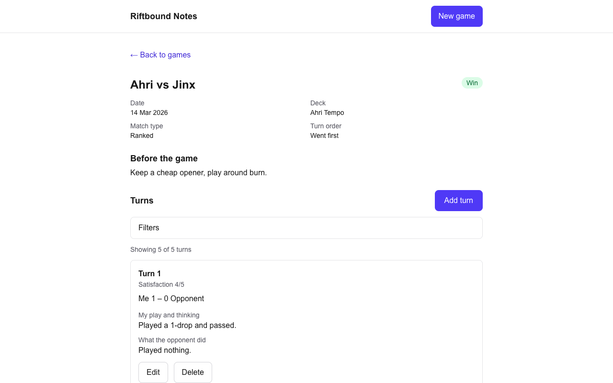

# Riftbound Notes

Riftbound Notes is a quick-entry note-taking app for logging Riftbound TCG games while you play. It is phone-first, built for one person, and keeps all data in your browser: there is no backend and no login.

## Screenshots

| | |
| --- | --- |
|  |  |
| Games list (phone, 375 px) | Game detail with turn log (phone) |
|  | |
| Add turn quick-entry form (phone) | |



Games list (laptop, 1280 px)



Game detail (laptop)

## Features

- Create, view, edit and delete games (date, deck name, both legends, went first/second, match type, result).
- Turn log on each game page with quick entry: turn number auto-increments and previous scores are pre-filled; scores 0-8 for each player, satisfaction 1-5, and a flag (none, mistake, great play).
- Separate free-text notes for "my play and thinking" and "what the opponent did" on each turn, plus before-game notes and an after-game reflection.
- Add, edit and delete turns inline, with a confirm step before deleting.
- Filters on the games list (result, legend matchup, date range) and on the turn log (turn, satisfaction, flag).
- Empty states on lists and a friendly "not found" for unknown games and unknown pages.
- Responsive layout for phone and laptop.

## Run it locally

Prerequisites: Node.js 20.9 or newer (the minimum required by Next.js 16.4.3, which this project uses) and npm.

```bash
git clone https://github.com/jonqschen/sprint-1-riftbound-notetaker.git
cd sprint-1-riftbound-notetaker
npm install
npm run dev
```

Then open http://localhost:3000. Always use that exact address: browser storage is per origin (including the port), so a different host or port shows empty data.

- In development, the empty state also offers a "Load demo games (dev only)" button. These dev buttons are not shown in production builds.
- Production build: `npm run build && npm start` (served at http://localhost:3000 by default).
- Lint: `npm run lint`

## Assignment requirements

| # | Requirement | How it is met | Where |
| --- | --- | --- | --- |
| 1 | Two or more pages, including a detail page with its own address that opens the right item directly | Games list, new game, game detail, edit game. Opening `/games/<id>` directly loads that game. | `app/page.tsx`, `app/games/new/page.tsx`, `app/games/[id]/page.tsx`, `app/games/[id]/edit/page.tsx` |
| 2 | Create, edit and delete the main thing | Games are created and edited with one form and deleted with a confirm step. Turns can be added, edited and deleted on the detail page. | `components/GameForm.tsx`, `components/TurnLog.tsx`, `lib/storage.ts` |
| 3 | Data persists after reload and after closing and reopening the tab, with a researched storage choice | localStorage via a repository module, one versioned JSON blob. See the test results below and the decision record. | `lib/storage.ts`, `hooks/useGames.ts`, `docs/storage-decision.md` |
| 4 | No blank screens: empty state and friendly not-found | "No games yet" empty state, a loading message while storage is read, "Game not found" for unknown ids and "Page not found" for unknown routes. | `components/EmptyState.tsx`, `components/NotFound.tsx`, `app/not-found.tsx` |
| 5 | Usable responsive layout on laptop and phone | Mobile-first layout with 44 px minimum tap targets and a sticky "Add turn" bar on small screens; checked at 375 px and 1280 px for horizontal overflow. | `app/layout.tsx`, `components/` |

## Storage

Data is stored in the browser's localStorage as one versioned JSON blob under the key `riftbound-notes`. Only `lib/storage.ts` touches localStorage, so the storage can be swapped later by changing one file. localStorage fits because the data is small, filtering happens in JavaScript, and it needs no extra dependency. The research, the options compared (including why IndexedDB with Dexie was considered first) and the sources are in [docs/storage-decision.md](docs/storage-decision.md).

## Test results

Date: 2026-10-26. Method: automated headless Chrome with a persistent profile, run against a production build (`npm run build && npm start`). Data was created through the real forms. "Close and relaunch" means the browser context was closed and reopened with the same profile directory.

| # | Check | Result |
| --- | --- | --- |
| 1 | First visit with empty storage shows the "No games yet" empty state | PASS |
| 2 | Creating a game lands on `/games/<id>` | PASS |
| 3 | Add two turns and edit one | PASS |
| 4 | Edit the game (deck name) | PASS |
| 5 | Full page reload keeps everything | PASS |
| 6 | Close and relaunch the browser: games list and the detail page opened directly by URL are still there | PASS |
| 7 | Delete a game (with confirm step), relaunch: it is gone and the other game remains | PASS |
| 8 | `/games/nope` shows the friendly "Game not found" message | PASS |
| 9 | `/nope-route` shows the global "Page not found" page | PASS |
| 10 | No horizontal overflow at 375 px and 1280 px on `/`, `/games/new` and the detail page | PASS |
| 11 | Deleting the last remaining game shows the empty state again | PASS |

Not tested: real phone hardware, Safari and Firefox (only Chrome was used), the storage-full path (a failed save), and syncing between multiple open tabs.

## Project structure

```
app/          routes: / , /games/new , /games/[id] , /games/[id]/edit , not-found
components/   forms, turn log and cards, filters, empty and not-found views
hooks/        useGames (hydration-safe access to storage)
lib/          types, storage (localStorage repository), filters, turn helpers, demo seed data
docs/         storage decision record and README screenshots
```

## Built with Claude Code

This app was built with Claude Code. `AGENTS.md` and `CLAUDE.md` at the repo root hold the project rules and requirements the agent followed. It was built in phases, with one commit per phase.

## Known limitations

- Data lives only in this browser. Clearing site data, or the browser evicting storage, deletes it.
- Storage is per origin, so a different host or port shows empty data (the dev server is pinned to port 3000). Private windows do not keep data after closing.
- There is no export button yet: `lib/storage.ts` has an `exportAll` function, but nothing in the UI calls it, so there is no backup in the app.
- The "Load demo games" and "Clear all data" buttons are dev-only helpers (hidden in production builds).
- Scores are limited to 0-8 and turn numbers are entered by hand (pre-filled with the next number), as designed.
